# Fraud Detection System

Detects fraudulent credit card transactions on the Kaggle **Credit Card Fraud Detection** dataset (284,807 transactions, 492 fraud cases), and tests honestly which parts of a hybrid pipeline (Isolation Forest anomaly score, SMOTE oversampling) actually help.

## Problem and objective

Only about 0.17% of transactions are fraud, so accuracy is meaningless and every false alarm has a cost. The objective is to catch as much fraud as possible at a fixed, low false-positive rate, with an evaluation that avoids data leakage, and to report the uncertainty openly, because the held-out test set contains only 95 fraud cases.

## Approach

1. **Cleaning:** drop 1,081 exact duplicate rows (284,807 become 283,726 transactions; fraud cases 492 become 473).
2. **Features:** the 28 PCA components, log amount and an hour-of-day feature (30 base features), plus an out-of-fold **Isolation Forest anomaly score** for the hybrid model (31 inputs).
3. **Split:** stratified 80/20 split (226,980 train with 378 fraud / 56,746 test with 95 fraud). The test set is used once, at the end.
4. **Four models compared on the same test set:**
   - A. Isolation Forest alone (unsupervised)
   - B. XGBoost + SMOTE, no anomaly feature
   - C. Isolation Forest score + XGBoost, no SMOTE
   - D. Hybrid: Isolation Forest score + XGBoost + SMOTE (the saved model)
5. **Leakage control:** SMOTE runs only inside training folds; Isolation Forest scores of training rows are out-of-fold; test rows are scored by a forest fitted on the training set only.
6. **Tuning:** randomised search with 5-fold stratified cross-validation, scored on PR-AUC (hybrid model only; B and C reuse its parameters).
7. **Threshold:** chosen on out-of-fold training predictions to meet a false-positive-rate budget, then applied once to the test set.
8. **Uncertainty:** Wilson 95% confidence intervals on recall and false-positive rate, a bootstrap interval on PR-AUC, and repeated stratified hold-outs (mean ± std).

## Findings

All numbers are on the held-out test set (56,746 transactions, 95 fraud, base rate 0.17%).

### Which model is best?

| Model | ROC-AUC | PR-AUC | Recall at 0.05% FPR | Recall at 0.1% FPR | Recall at 0.5% FPR |
|---|---|---|---|---|---|
| A. Isolation Forest only | 0.944 | 0.125 | 10.5% | 20.0% | 41.1% |
| B. XGBoost + SMOTE (no IF) | 0.977 | 0.813 | 80.0% | 81.1% | 85.3% |
| C. IF + XGBoost, no SMOTE | 0.975 | **0.824** | 81.1% | **83.2%** | 85.3% |
| D. Hybrid IF + XGBoost + SMOTE | **0.979** | 0.816 | 80.0% | 81.1% | **86.3%** |

Recall at a given FPR in this table uses the best possible threshold on the test set, so it is for comparing models only. The deployable numbers are below.

<p>
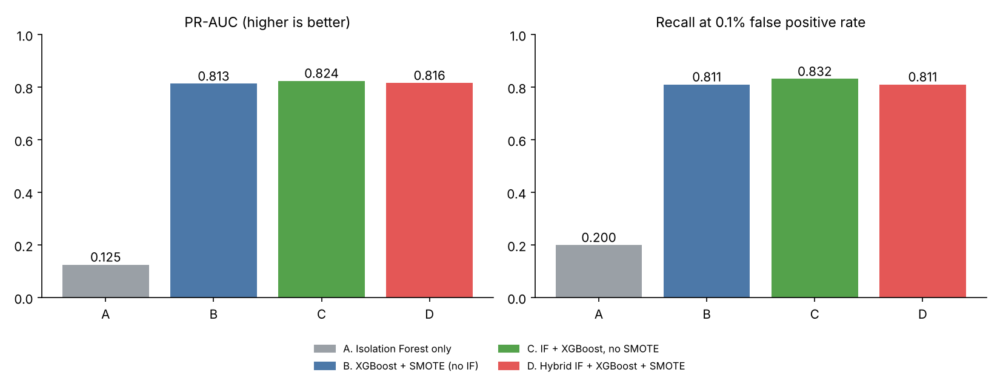
</p>

- **Supervised learning wins by a wide margin.** The Isolation Forest alone has a good-looking ROC-AUC (0.944) but a PR-AUC of only 0.125, so most of what it flags is not fraud. ROC-AUC flatters models on data this imbalanced; PR-AUC and recall at a fixed FPR tell the real story.
- **SMOTE and the anomaly feature did not give a measurable gain.** The model without SMOTE (C) scored slightly higher on PR-AUC (0.824 vs 0.816), and removing the anomaly feature (B) changes PR-AUC by only 0.003. These gaps correspond to one or two fraud cases out of 95 and are far smaller than the uncertainty: the hybrid's own PR-AUC has a 95% interval of 0.752 to 0.900. The honest conclusion is that the hybrid is **not shown to be better** than plain XGBoost here. The anomaly score also contributes little to the final model: it ranks 15th of 31 features by gain (see below).

### Deployable operating points

Threshold chosen on out-of-fold training predictions for a target false-positive rate, then applied once to the test set (hybrid model).

| FPR budget | Threshold | Recall (95% CI) | Actual FPR (95% CI) | Precision | Caught / missed | False alarms |
|---|---|---|---|---|---|---|
| 0.05% | 0.221 | 80.0% (70.9% to 86.8%) | 0.055% (0.039% to 0.078%) | 71.0% | 76 / 19 | 31 |
| **0.1% (headline)** | **0.112** | **82.1% (73.2% to 88.5%)** | **0.117% (0.092% to 0.148%)** | **54.2%** | **78 / 17** | **66** |
| 0.5% | 0.022 | 86.3% (78.0% to 91.8%) | 0.537% (0.480% to 0.600%) | 21.2% | 82 / 13 | 304 |

<p>
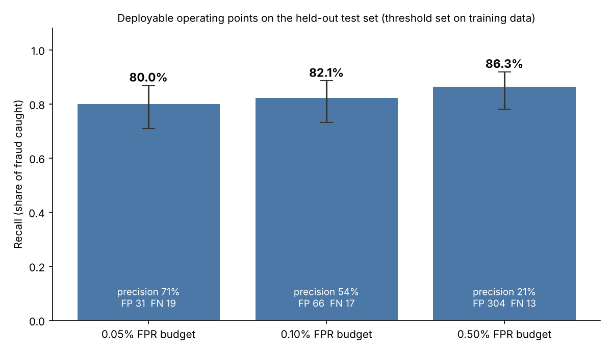
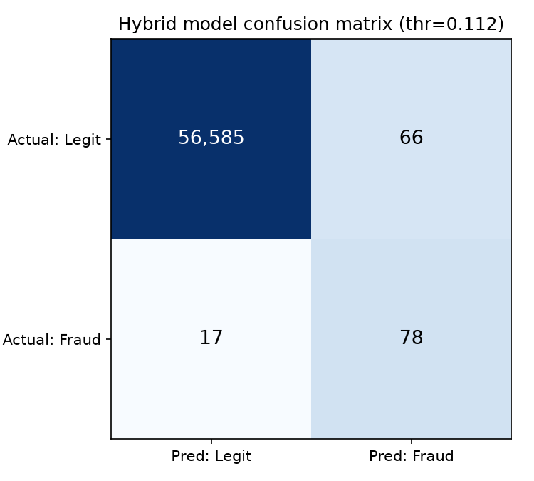
</p>

- At the headline setting the model catches 78 of 95 frauds and raises 66 false alarms, about **0.85 false alarms per fraud caught**, out of 56,651 legitimate transactions.
- The realised false-positive rate is slightly above each budget, but the 95% interval includes the budget in all three cases, so this is consistent with sampling noise.
- **Across repeated stratified hold-outs** (mean ± std; the script's default is five runs): recall 82.5% ± 3.2 points, false-positive rate 0.118% ± 0.012 points, precision 54.1% ± 2.7 points, PR-AUC 0.807 ± 0.041. The single test split agrees with these repeated runs, and a standard deviation of about 3 points in recall is what 95 fraud cases allow.
- **Latency:** median 12.7 ms per transaction (95th percentile 17.4 ms) for Isolation Forest scoring plus XGBoost, one row at a time on a single thread. Batch XGBoost scoring alone runs at about 92,000 transactions per second. Timings depend on the machine they were measured on.

<p>
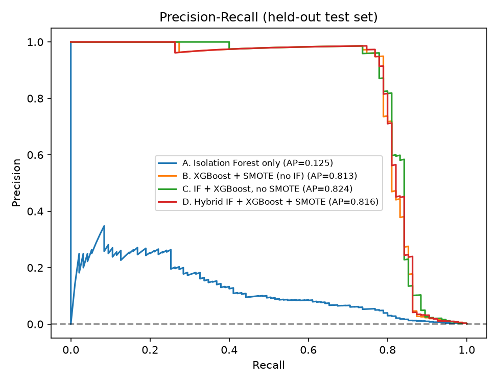
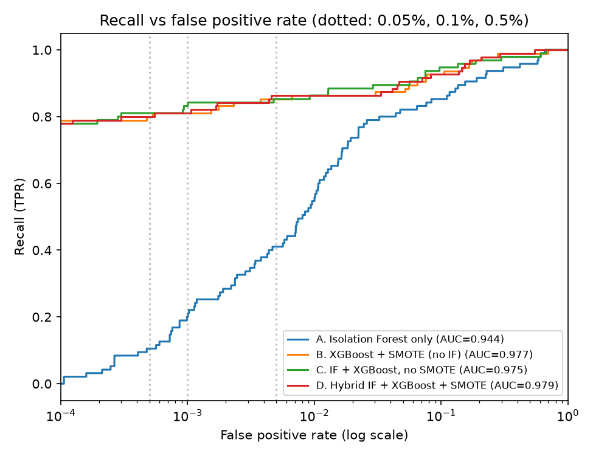
</p>

### What drives the predictions

The most important features by gain are `V14`, `V10`, `V17`, `V12` and `V4`. These are anonymised PCA components, so they cannot be interpreted as business features. The Isolation Forest score ranks only 15th of 31 features (the last bar in the chart, a gain of about 0.01 against about 0.50 for `V14`), consistent with the ablation above.

<p>
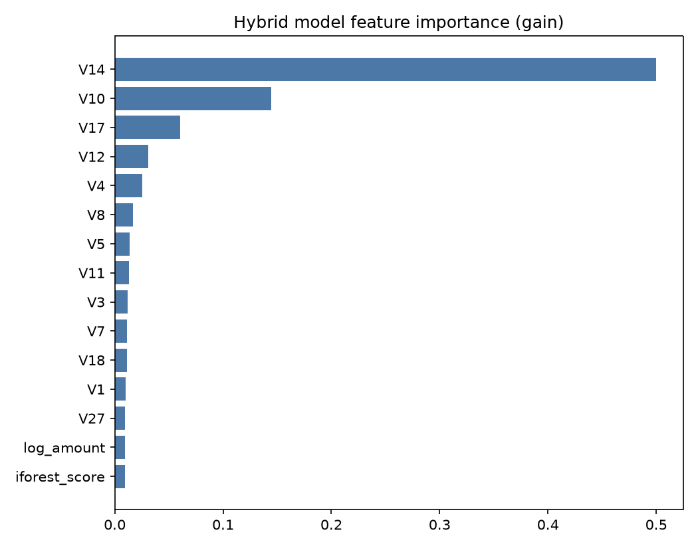
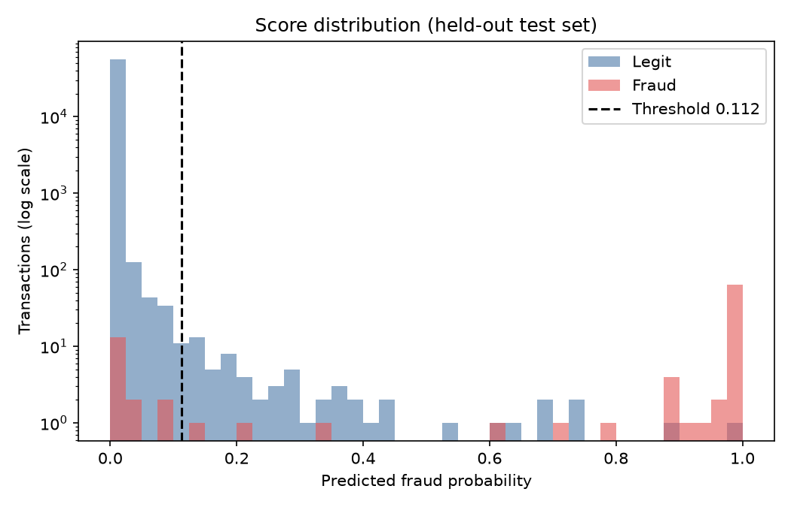
</p>

### What the exploratory analysis shows

<p>
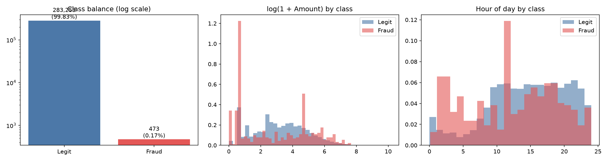
</p>

Fraud transactions have a different amount profile (including a visible spike at very small amounts) and a different time-of-day shape from legitimate ones. On the held-out test set the fraud rate is U-shaped across amount bands: 0.53% for amounts under 1 and 0.63% above 500, against 0.17% overall and 0.09% for amounts between 10 and 100. `Time` counts seconds from the first transaction, so "hour of day" is relative to the start of the two-day window, not a clock time. The SQL queries in `sql/` quantify these patterns on the raw data.

### What the results do and do not show

- They show that a supervised gradient-boosted model detects most fraud at a very low false-positive rate, and that the unsupervised score on its own is not a usable detector here.
- They do **not** show that SMOTE or the hybrid design improves on plain XGBoost. The comparison models reuse the hybrid's tuned parameters rather than being tuned separately, and no variant with neither SMOTE nor the anomaly feature was tested.
- With 95 fraud cases, every recall figure has a wide confidence interval (about ±7 to 8 points). Differences of one or two caught frauds are not meaningful.
- The best hyper-parameters sit at the edge of the search grid (`max_depth` 6, `n_estimators` 500, `learning_rate` 0.03, `reg_lambda` 1, `gamma` 0), so a wider search might add a little.

## Dashboard

Two report pages built from the scored held-out test set. The images are generated by `dashboard/build_dashboard.py` with the same logic as the Power BI measures in `dashboard/measures.dax`; they are not exported from Power BI. `dashboard/README.md` explains how to build the interactive Power BI version.

<p>
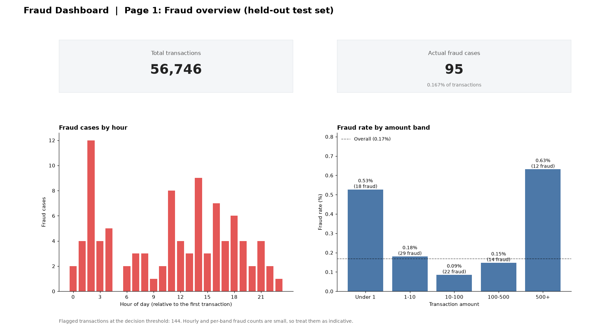
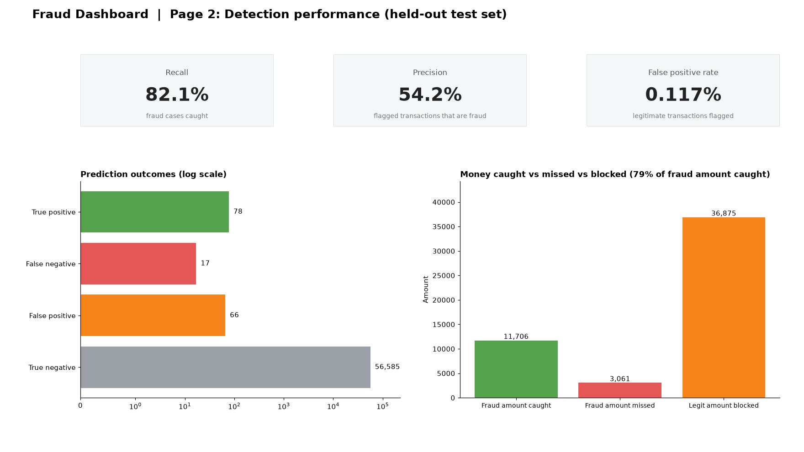
</p>

What the pages show (95 fraud cases in total, so the per-hour and per-band counts are indicative only):

- **Amount matters at both ends.** Fraud rate by amount band is highest for very small amounts (0.53%, 18 cases) and for amounts above 500 (0.63%, 12 cases).
- **Money, not just counts.** At the headline threshold the model catches about 79% of the fraud amount (11,706 caught, 3,061 missed). The legitimate amount blocked by false alarms is 36,875, about three times the fraud amount caught, because the 66 false alarms average about 559 per transaction while the 78 caught frauds average about 150. A flat false-positive budget ignores this, and a cost-weighted threshold would be the next improvement.

## Streamlit app

Score a CSV of transactions, score a single transaction, or review model performance.

<p>
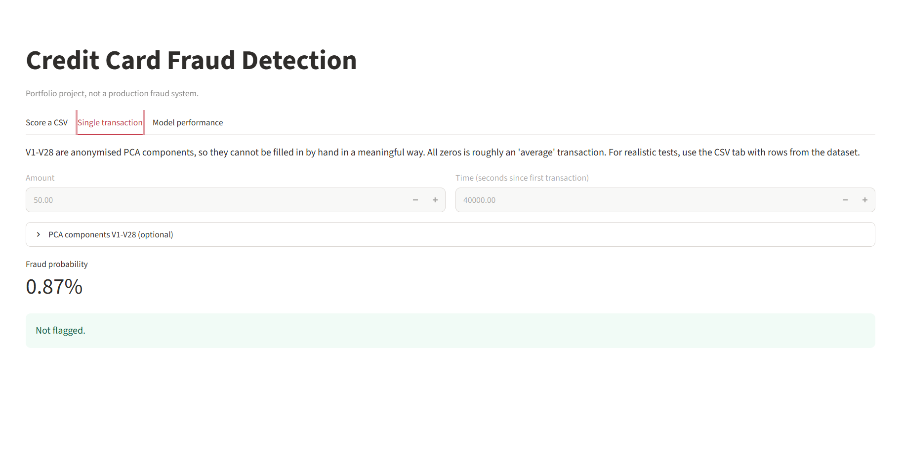
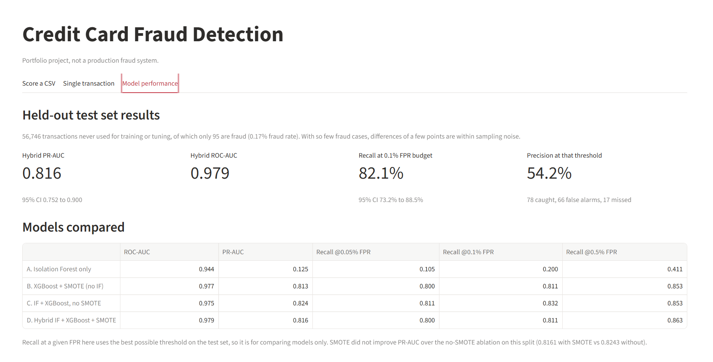
</p>

The V1 to V28 inputs are anonymised PCA components and cannot be filled in meaningfully by hand, so the CSV tab (using rows from the dataset) is the realistic way to test the model.

## Repository structure

| Path | Content |
|---|---|
| `README.md` | This file |
| `data/` | Dataset download instructions, schema and known data issues (the raw file is not committed) |
| `notebooks/` | `01_eda.ipynb` and `02_experiments.ipynb` (committed without outputs) |
| `src/` | Pipeline code: `data.py`, `models.py`, `evaluate.py`, `train.py`, `export_scores.py`, `predict.py` |
| `models/` | Saved model bundle, `metrics.json` and figures from the committed run, plus how to reproduce them |
| `sql/` | Schema, SQLite loader and 7 queries (fraud by hour and amount band, largest frauds, detection performance, money caught vs missed, score bands) |
| `dashboard/` | Dashboard image generator (`build_dashboard.py`), Power BI data contract, DAX measures, layout guide and screenshots |
| `tests/` | Unit tests for features, metrics, thresholds and the Isolation Forest scoring |
| `docs/` | App screenshots used in this README |
| `app.py` | Streamlit app: score a CSV, score one transaction, view model performance |
| `requirements.txt` | Python dependencies |

## How to run

Run every command from the repository root.

```bash
pip install -r requirements.txt

# 1. get the data: see data/README.md  (place creditcard.csv in data/)

# 2. train (writes models/, models/figures/ and dashboard/powerbi_data/scored_test.csv)
python -m src.train --data data/creditcard.csv
#    quick smoke test without the dataset:  python -m src.train --synthetic --n-iter 2 --repeats 1

# 3. check the committed model reproduces the reported numbers (no retraining)
python -m src.export_scores --data data/creditcard.csv

# 4. SQL analysis
python sql/load_sqlite.py
python -c "import sqlite3; con=sqlite3.connect('sql/fraud.db'); cur=con.execute(open('sql/02_fraud_by_hour.sql').read()); print([d[0] for d in cur.description]); [print(r) for r in cur.fetchall()]"
#    (or, if you have the sqlite3 tool: sqlite3 sql/fraud.db < sql/02_fraud_by_hour.sql)

# 5. dashboard images (details in dashboard/README.md)
python dashboard/build_dashboard.py

# 6. app
python -m streamlit run app.py

# 7. tests
python -m pytest
```

The repository already contains the trained model, so steps 3 to 6 work without retraining. Step 3 prints the confusion counts at the saved threshold and tells you whether they match `models/metrics.json` (78 caught, 66 false alarms, 17 missed at the headline threshold).

## Limitations and next steps

- The split is random, not time-based, so results are probably slightly optimistic. `notebooks/02_experiments.ipynb` includes a time-based check.
- The data covers two days of European card transactions from 2013, with anonymised features and no customer or merchant history. The PCA transformation was applied by the dataset's authors before release, so its fit cannot be restricted to training rows.
- The threshold uses a flat false-positive budget. A real system would weigh each missed fraud and each false alarm by its amount: at the headline threshold the legitimate amount blocked is about three times the fraud amount caught.
- The ablation is incomplete (see above) and its comparison models are not separately tuned.
- No drift monitoring, delayed-label handling or explanations (for example SHAP) are included.
- Possible next steps: a plain-XGBoost baseline, separate tuning per model variant, cost-weighted thresholds, SHAP explanations, and LightGBM or CatBoost comparisons.

## Disclaimer

Portfolio project for learning purposes. It is not a production fraud system. Please follow the dataset's licence and citation requirements on Kaggle.
